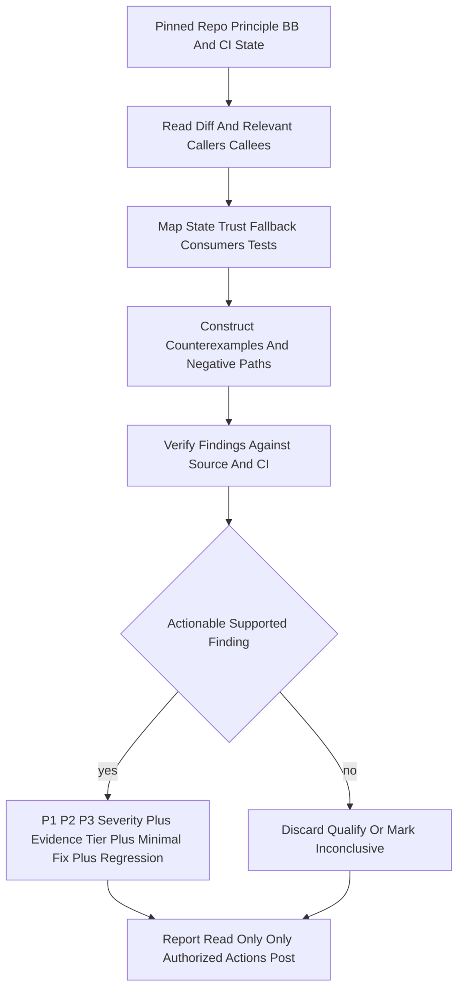
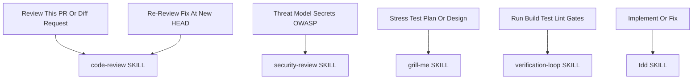
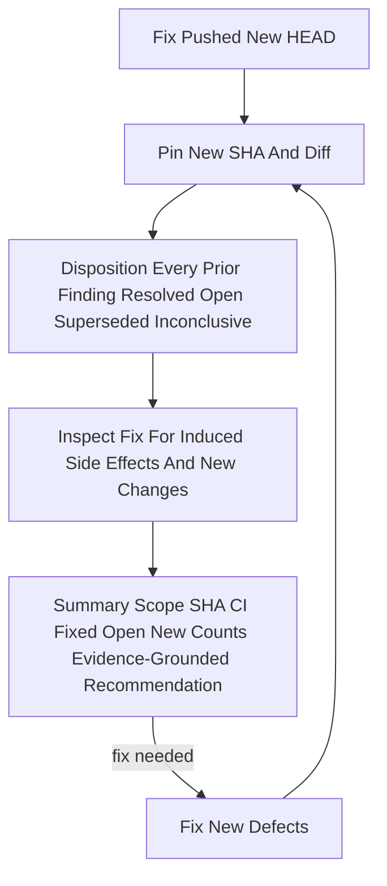

# Workflow: Code Review

> Independently review a PR, diff, or finished implementation for correctness, contract, and negative-path defects — read-only by default, with evidence-tiered, source-anchored findings.

Source of truth: `code-review/SKILL.md`.

Contract summary from SKILL.md — Trigger: requested review of a PR, diff, implementation, or revised HEAD. Output: source-anchored findings and an evidence-qualified summary. USE FOR: review a PR/diff/finished implementation before merge, re-review a revised HEAD (prior-finding disposition + new risks). DO NOT USE FOR: security-only threat modeling/secrets/OWASP (use `security-review`); design or plan stress-testing (use `grill-me`); running gates (use `verification-loop`); writing the fix (use `tdd`).

## 1. Skill Behavior Workflow

## 2. Triggering and Routing Path

## 3. Re-Review Cycle

Template: `code-review/templates/finding.template.md`. Deep dive: `code-review/references/review-playbook.md`.

## 4. Verification Check

- [ ] Repository, contract, base/head SHA, changed scope, and CI state pinned before reviewing
- [ ] Independent pass completed; author explanations and tests treated as leads, not proof
- [ ] Applicable counterexamples constructed (missing/malformed input, persisted state, transitions, boundaries, degraded dependencies, OS/shell, concurrency); irrelevant categories not forced
- [ ] Every reported finding carries exact path:line/diff anchor at HEAD, trigger, observed behavior, violated contract, impact, evidence tier (executed / source-traced / inconclusive), smallest fix, negative regression, and positive control
- [ ] Prior findings dispositioned at the new HEAD on re-review, plus fix-induced regressions inspected
- [ ] Review stayed read-only unless explicitly authorized; no edits, comments, labels, or merges on review authority
- [ ] Summary distinguished "no actionable findings in examined scope" from "bug-free," with test/CI/live-host evidence boundaries stated
