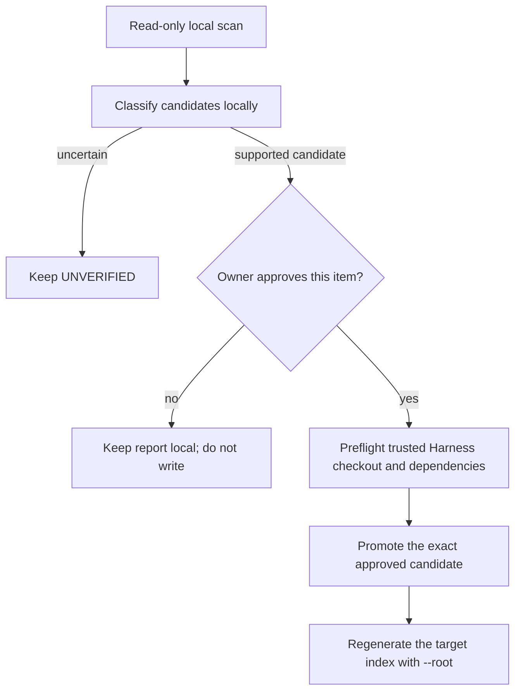

# Workflow: Error Ledger Bootstrap

> Inventory local evidence for an existing repository and write only owner-approved ledger entries.

Detailed source privacy, classification, approval, promotion and Windows guidance lives in [the workflow reference](../../error-ledger-bootstrap/references/workflow.md).

