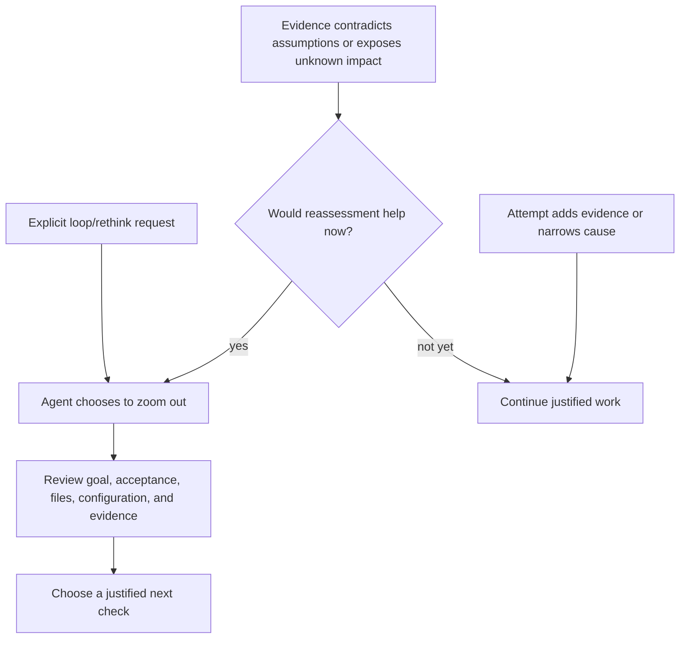
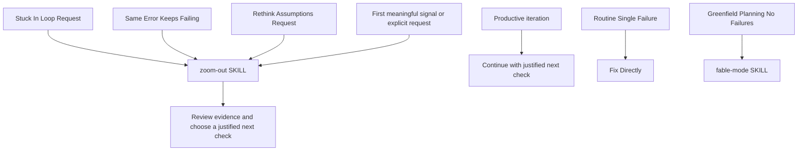
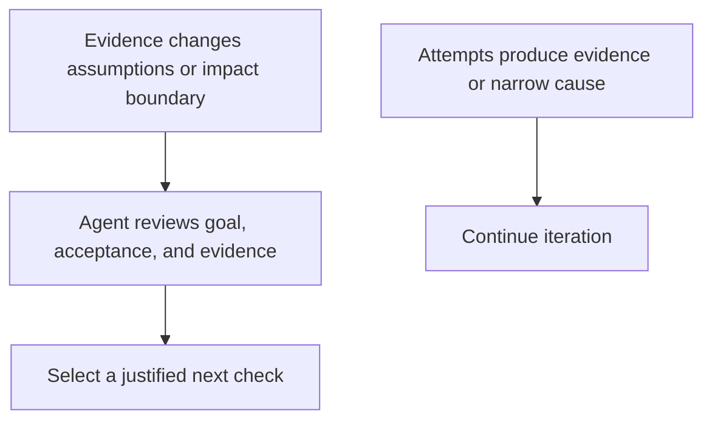

# Workflow: Zoom Out

> Agent-initiated reassessment when evidence contradicts an assumption or reveals an unknown impact boundary. A first failure may be enough; productive work can continue when attempts add evidence or narrow the cause.

Source of truth: `zoom-out/SKILL.md`.

Zoom-out is voluntary. An agent may choose it on the first meaningful signal or an explicit loop/rethink request, and may continue productive iteration when the next check is justified by new evidence. The former `rule-of-3*.js` counter, `reset-circuit-breaker.js`, forced report/unlock path, and OpenCode hard-lock path are retired under [#394](https://github.com/dyphn1/Harness-everything/issues/394). No counter, lock, reflection token, compulsory report, reset, or automatic escalation is part of this procedure. A short fact-check note can help organize reassessment, but no special artifact is required.

## 1. Skill Behavior Workflow

## 2. Triggering and Routing Path

## 3. Real-World Use Case

Optional note template: `zoom-out/templates/zoom-out-report.template.md`. The former enforcement hook is retired under [#394](https://github.com/dyphn1/Harness-everything/issues/394). The linked [`zoom-out/references/circuit-breaker.md`](../../zoom-out/references/circuit-breaker.md) describes the retired mechanism and is historical reference material.

## 4. Verification Check

- [ ] The agent chose whether reassessment would improve the next step; it may start on the first meaningful signal
- [ ] When reassessing, the goal, acceptance, files, configuration, and evidence were checked before choosing the next step
- [ ] Productive iteration continued when attempts added evidence or narrowed the cause
- [ ] No failure counter, lock, reflection token, compulsory report, reset, or automatic escalation was assumed
