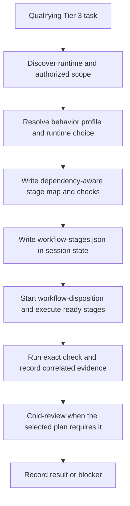

# Fable Mode — Execution Phases



## Discovery and planning

Read relevant files and sources before producing an artifact. Record the
authorized write scope. Give each stage an objective, dependencies, write set,
expected output, exact check command, and pass condition. Required and optional
bindings belong on the stage that needs them. Replan counts are advisory; after
three same-signature failures, use Rule-of-3 `zoom-out`.

## Profiles and delegation

Resolve a requested behavior profile with Fable's profile selector and record
it separately from the runtime choice. `fable-orchestrator`,
`fable-worker-sonnet`, and `fable-worker-haiku` name coordination,
reasoning/synthesis, and mechanical-work roles. These are behavior-profile
aliases; they do not switch the runtime model. Preserve an explicit user or
host runtime choice. Workers do not spawn workers. If a named worker is
unavailable, use a declared inline fallback or report the gap.

## Active workflow

For an active mandatory workflow, use the router-displayed session path for
`workflow-stages.json` and the router-displayed `workflow-disposition.js`
controller. Do not register active stages in a repository-local contracts
directory. Every required stage needs `dependsOn`, `writeSet`, `checkCommand`,
and `passCondition`; an independent plan also needs a read-only `fable-verifier`
stage that depends on all implementation stages.

Start the selected run with the controller path and session id from the router:

```bash
node "<workflow-disposition.js path from the router>" start --session-id "<session-id>"
```

The controller creates correlated run-scoped contracts. Load only bindings on
dependency-ready stages. Record each disposition with evidence:

```bash
node "<workflow-disposition.js path from the router>" stage-binding \
  --session-id "<session-id>" --stage-id "<stage-id>" \
  --binding-id "<binding-id>" --disposition loaded \
  --evidence "Read the resolved required reference for this stage."
```

Run the exact `checkCommand`; the post-tool `contract-test.js` records the
session, run, stage, worker identity, numeric exit code, and check evidence. If
bindings are unresolved, resolve them and rerun the exact check before passing
the stage. Keep results under the run's `contracts/<stageId>.json` and
`evidence/<stageId>.json` records. Stage checks, required bindings, and selected
independent verification remain semantic MUSTs. The controller and lifecycle
hooks are reminder-only: unresolved evidence stays visible without locking
ordinary tools or Stop. See [`../CONTRACT-FORMAT.md`](../CONTRACT-FORMAT.md) for
the schema and correlation rules.

## Blocked recovery

If `start` is called while the workflow is running, it exits 2 with
`workflow already running; record a blocker before replanning`. From that
running state, record evidence with `block`:

```bash
node "<workflow-disposition.js path from the router>" block \
  --session-id "<session-id>" \
  --evidence "The current stage map needs a bounded recovery update."
```

Update the same session's `workflow-stages.json`, retaining the approved
requirements, workflow selection, dependencies, and required bindings. Then
start the revised stage map:

```bash
node "<workflow-disposition.js path from the router>" start --session-id "<session-id>"
```

This starts a new run and clears the recorded block reason. If the session is
already `blocked`, update its stage map and run `start` directly. Do not call
`plan` from `blocked`: planning is accepted only while the workflow is pending
or active. When an explicitly authorized scope change requires new requirement
composition, route a new session instead of replacing approved requirements.

## Legacy/manual fallback

The path `.claude/harness-everything/state/contracts/<stage>.json` belongs only
to an explicitly selected legacy/manual workflow without an active mandatory
run. It does not register stages or correlated evidence for the current
workflow controller. Do not use it for an active Fable workflow.

## Verification and handoff

Run each named check and review scope-guard evidence before delivery. When the
selected plan requires independent verification, the verifier is read-only and
uses a distinct worker identity after all other stages pass. Record a blocker
or an evidence-backed result; do not discard unresolved requirements.
