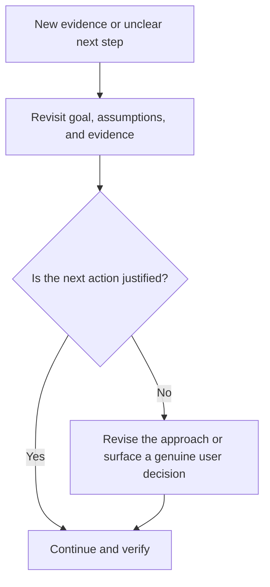

# Zoom Out — Voluntary Diagnosis Guidance

This reference helps an agent decide whether a fresh diagnosis would improve the next step. It does not impose a trigger or pause.

## Reassessment path

An agent may reassess at the first meaningful signal or later. A run may continue when attempts add evidence, narrow the cause, and justify the next check. Neither a failure count nor review history forces a pause.

## Make the diagnosis concrete

- Restate the goal and the acceptance clause that matters.
- List observed results and assumptions separately; include which attempted changes were informative.
- When the issue may span consumers, inventory callers and state readers before choosing a correction.
- Group findings by the acceptance decision they affect. Keep findings with no matching clause unresolved for the owner instead of inventing extra scope.
- Select the smallest next check or change that distinguishes the remaining explanations.

If a review or repair reveals the same decision problem at another site, trace all sites that make that decision before editing again. Productive iteration remains valid while it keeps reducing uncertainty.

## Optional record

A written summary can help a handoff or preserve a useful diagnosis, but no report, token, unlock, reset, or escalation ritual is required. When a note helps, record the goal, evidence, changed understanding, next action, and any decision that belongs to the user. The template at `<this-skill-dir>/templates/zoom-out-report.template.md` is optional.
