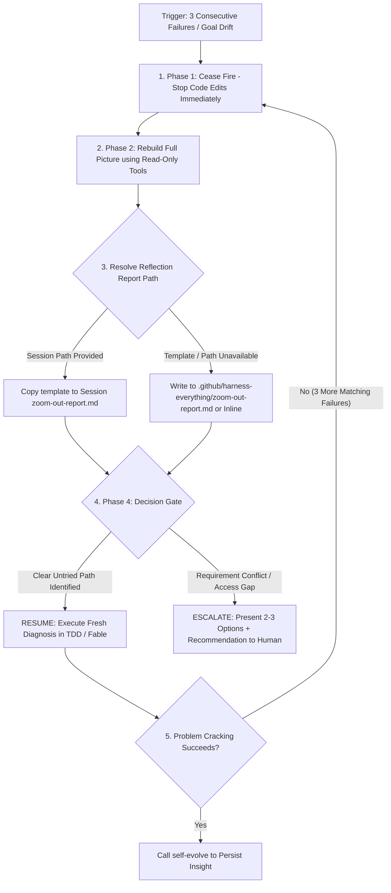

# Zoom Out — Circuit Breaker (Full Detail)

## Process & Circuit Breaker Resolution Flow

Follow the decision matrix below when hitting a circuit breaker:

## 1. Triggers
- **Rule of 3 (Repeated Failures)**: Attempting to fix the same error or test failure 3 times without progress.
- **Divergence**: Fixing one bug repeatedly introduces new secondary errors.
- **Repair loop (feature level)**: Two consecutive review or fix rounds on the same feature each surface new defects in the same decision class (for example "is this the trusted checker?"), even though every command succeeded.
  - The Rule of 3 hook cannot see this. It counts same-signature command failures in one session. Successful review findings do not increment it, and unrelated successes can leave an existing count in place. New sessions and different failure signatures do not accumulate a feature's review history.
  - The signal comes from review history: prior findings and their dispositions, the round count per class in an error ledger, or the reviewer noticing the pattern. It is a prompt to reflect, not a lock. The hook gate in the skill contract applies only to the three-failure trigger.
  - "Same decision class" means the same acceptance decision under the same trust assumptions, possibly at different sites. "Same directory" or "validation" is too broad. Count a repeated or renamed finding once, and treat missing history as unknown, not zero.
  - Phase 2 here means: list every finding so far by decision class, state the acceptance clause each violates, and inventory every site (callers, state readers, Stop consumers) that makes the same decision. Findings that map to no acceptance clause stay `unresolved` for the owner instead of becoming new fixes.
  - RESUME by using the inventory to choose the smallest justified correction (which may be one shared fix, or no code change), then re-trace one normal end-to-end acceptance path. Unresolved findings need scope adjudication, not speculative repairs.
  - A one-shot reviewer cannot see the previous round on its own. The packet carries the current acceptance anchor, a link to the previous comparable report with its revision, the prior finding IDs and dispositions, and the fix made since.
- **Goal Drift**: Execution strays far from the initial task objective.
- **User Instruction**: The user requests a step back ("zoom out", "step back", "stop and think").

## 2. Phase 1 — Cease Fire
- Pause code editing attempts immediately.
- Refrain from guessing quick fixes without checking underlying facts first.

## 3. Phase 2 — Rebuild Full Picture (Reflect & Fact-Check)
Use read-only tools (Read / Grep / Glob) to gather fresh evidence:
1. **Restate Goal**: Review original objectives from task/todo context.
2. **Examine Failed Attempts**: Identify the underlying belief behind each failed fix.
3. **Fact-Check Assumptions**: Verify files, configuration, logs, and docs directly.
4. **Elevate Perspective**: Check for layer mismatches, API contract misunderstandings, or conflicting requirements.
5. **Form Fresh Diagnosis**: Synthesize a comprehensive explanation that accounts for all observed evidence.

## 4. Phase 3 — Write Reflection Report
Copy `zoom-out/templates/zoom-out-report.template.md` to the `zoom-out-report.md` path given in the Rule of 3 message and fill it in section by section.

A complete report automatically releases the circuit breaker on hook-enabled systems.

## 5. Phase 4 — Decision Gate: Resume or Escalate

- **RESUME**: Selected when the fresh diagnosis identifies a clear, untried path within existing authority.
- **ESCALATE**: Reserved for true decision points belonging to the user (conflicting requirements, destructive migration, missing credentials/access, or repeated breaker trips that expose a genuine decision or access gap).
Hand the human a **decision**, not a plea:

> "Goal: [...]. I falsified paths X, Y, Z — verified facts: [...].
> The real blocker is a [requirement conflict / architecture trade-off / destructive step / access gap], which is your call, not mine.
> Option A: [...] (trade-off: ...). Option B: [...] (trade-off: ...).
> I recommend A because [...]. Which direction do you choose?"

Banned: "I have tried everything and failed, please help." That reports incapability, not a decision.

## 7. Recovery
- **Self-recovery path**: a valid report ending in `RESUME` releases the breaker — reload the appropriate execution mode (`tdd`, `fable-mode`) and execute the new diagnosis. If the SAME failure signature accumulates 3 more failures, start another zoom-out/reflection cycle.
- **Human path**: after the human answers an `ESCALATE`, continue under their direction. `npm run harness:reset` (or a new session / `/clear`) is an optional manual state clear for recovery or maintenance; it is not required merely because the breaker re-tripped.
- Either way, once the problem is ultimately cracked, feed the insight to `self-evolve`.
